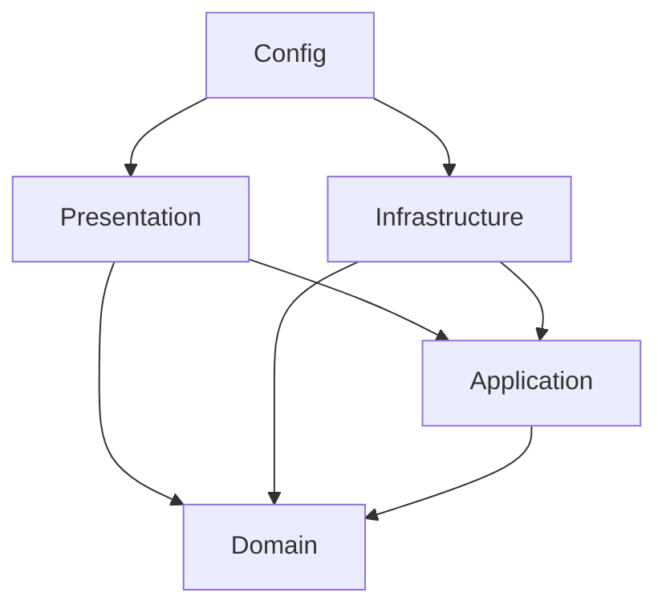

# Spring Boot Auth Template

Template de backend de **autenticação e autorização** pronto para produção, em Spring Boot 4.1 / Java 27, seguindo **Clean Architecture**, **DDD** e casos de uso no estilo **CQRS** — com as fronteiras entre camadas verificadas no build (ArchUnit), não só por convenção.

Não é um starter de brinquedo: já vem com tudo que um backend real precisa no primeiro dia — JWT com rotação de refresh token, RBAC, upload com validação de conteúdo, e-mail e notificações assíncronos, cache Redis, observabilidade, Docker, CI e uma suíte de testes representativa — para novos serviços nascerem a partir dele em vez de serem reconstruídos do zero.

---

## Sumário

- [Funcionalidades](#funcionalidades)
- [Stack tecnológica](#stack-tecnológica)
- [Arquitetura](#arquitetura)
- [Estrutura do projeto](#estrutura-do-projeto)
- [Começando](#começando)
- [Variáveis de ambiente](#variáveis-de-ambiente)
- [Comandos](#comandos)
- [Documentação da API e versionamento](#documentação-da-api-e-versionamento)
- [Endpoints](#endpoints)
- [Filas, cache e WebSocket](#filas-cache-e-websocket)
- [Testes](#testes)
- [Docker](#docker)
- [CI](#ci)
- [Observabilidade](#observabilidade)
- [Decisões de projeto](#decisões-de-projeto)

---

## Funcionalidades

**Auth e autorização**
- Registro / login com access token JWT (HS256, 1h)
- Refresh token rotacionado via cookie `httpOnly` + `SameSite=Strict` (o antigo é revogado a cada rotação), limitado a 5 sessões simultâneas por usuário (a mais antiga é descartada, nunca rejeitada)
- Gestão de sessões: listar sessões ativas e revogar qualquer uma, além de exclusão da própria conta
- Reset de senha e verificação de e-mail por token de uso único, com limpeza agendada dos expirados
- Política de senha aplicada na borda (Bean Validation) **e** no domínio (`Password`): 8–128 caracteres, maiúscula + minúscula + número
- Lockout por conta (5 falhas → 15 min; 3 lockouts em 24h → 24h) por cima do rate limit por IP, com contador atômico (`INCR`) no Redis — um reset de senha bem-sucedido limpa os dois
- RBAC: usuários ↔ roles ↔ permissões, com roles/permissões relidas do banco a cada requisição (revogação tem efeito imediato)
- Rate limit nos endpoints sensíveis (login, registro, reset) e global de 100 req/min por IP

**Plataforma**
- Upload de arquivos validado por **magic bytes** (não pelo `Content-Type`), allowlist de MIME, chave de storage à prova de path traversal; listagem/download/remoção restritos ao dono; download em streaming; remoção apaga os bytes, não só a linha
- E-mail e notificações assíncronos via **Redis Streams** (consumer group, retry com backoff exponencial, dead-letter, reclaim de mensagens pendentes de instância morta) com visão admin só em dev
- Cache-aside no Redis para leituras quentes, com invalidação explícita nas escritas
- Audit log estruturado das ações sensíveis, gravado fora do caminho da resposta
- Timeout + circuit breaker (Resilience4j) em volta dos jobs de fila

**Qualidade de engenharia**
- Camadas Domain / Application / Infrastructure / Presentation com dependências apontando só para dentro, **verificadas por ArchUnit** no `mvn test`
- Erros com código legível por máquina e `requestId` em todas as respostas (também no header `X-Request-Id` e em cada linha de log)
- API versionada em `/v1` desde o início; `/health` fora da versão
- Testes unitários (JUnit 5 + Mockito), de arquitetura (ArchUnit) e de integração ponta a ponta (Testcontainers com Postgres + Redis reais)
- Docker multi-stage, `compose.yaml` para Postgres + 2 Redis, GitHub Actions

---

## Stack tecnológica

| Preocupação | Escolha |
|---|---|
| Runtime | Java 27 / Spring Boot 4.1 |
| Banco | PostgreSQL 18 + Spring Data JPA (Hibernate 7) + Flyway |
| Redis | Redis 8.0 (duas instâncias: cache/rate limit/lockout e filas/pub-sub) |
| Validação | Bean Validation (`@Valid`, constraint composta `@ValidPassword`) |
| Auth | Spring Security 7 + Nimbus JOSE (JWT HS256) + `BCryptPasswordEncoder` |
| Autorização | `@RequireRole` / `@RequirePermission` (templates de `@PreAuthorize`) |
| CQRS | `record` de comando/consulta + handler `@Service` injetado no controller |
| Filas | Redis Streams (`StreamMessageListenerContainer`) + `/admin/queues` (dev) |
| Resiliência | Resilience4j CircuitBreaker + timeout em `QueueJobPolicy` |
| Cache | `StringRedisTemplate` + Jackson 3 atrás da porta `CachePort` |
| Rate limit | Interceptor `INCR`/`EXPIRE` no Redis (`@RateLimit`) |
| WebSocket | STOMP (`spring-websocket`) + Redis pub/sub para fan-out entre instâncias |
| Agendamento | `@Scheduled` |
| Sniffing de MIME | `MagicByteFileTypeDetector` (porta; troque por Tika se a allowlist crescer) |
| Configuração | `@ConfigurationProperties` validado (`AppProperties`) + `.env` via `spring.config.import` |
| Docs | springdoc-openapi (Swagger UI em `/docs`) |
| Observabilidade | Actuator + Micrometer/Prometheus + logs ECS JSON em prod |
| Fronteiras | ArchUnit |
| Testes | JUnit 5 + Mockito + Testcontainers |
| Build / CI | Maven Wrapper + Docker multi-stage + GitHub Actions |

---

## Arquitetura

Quatro camadas, dependências só para dentro. `config` é a *composition root* — o único pacote que enxerga tudo e onde as portas são ligadas às suas implementações:



- **Domain** — entidades e exceções de domínio. Java puro, zero anotações de framework.
- **Application** — casos de uso (`command/` e `query/` por agregado), DTOs e *portas* (interfaces) para tudo que só a infraestrutura provê: repositórios, cache, filas, hashers, storage.
- **Infrastructure** — adapters das portas: entidades/repositórios JPA, Redis (cache, rate limit, streams, pub/sub), segurança JWT, e-mail, storage, jobs.
- **Presentation** — controllers, DTOs de request, tratamento de erros, rate limit, request-id.

Essas regras estão em [`ArchitectureTest`](src/test/java/com/template/auth/ArchitectureTest.java) e falham o build quando violadas.

### Portas com dois adapters prontos

Troca por **variável de ambiente**, sem editar código:

| Porta | Padrão (zero-config) | Alternativa | Como trocar |
|---|---|---|---|
| `FileStoragePort` | `LocalFileStorage` (disco local) | `S3FileStorage` | `FILE_STORAGE=s3` + `AWS_S3_BUCKET` (+ `AWS_REGION`) |
| `EmailSenderPort` | `LogEmailSender` (só loga) | `SmtpEmailSender` | `EMAIL_SENDER=smtp` + `SPRING_MAIL_*` + `EMAIL_FROM` |
| `PasswordBreachCheckerPort` | `NoopPasswordBreachChecker` | `HibpPasswordBreachChecker` (HaveIBeenPwned, k-anonymity) | `PASSWORD_BREACH_CHECKER=hibp` |

---

## Estrutura do projeto

```
src/main/java/com/template/auth
├── AuthTemplateApplication.java
├── config/                      # composition root: Security, Redis, WebSocket, OpenAPI, AppProperties
├── domain/
│   ├── shared/                  # BaseEntity, DomainException + exception/*
│   ├── user/                    # UserEntity, Email (VO), Password (VO)
│   ├── role/  permission/
│   ├── refreshtoken/  passwordreset/  emailverification/
│   └── fileasset/  notification/  auditlog/
├── application/
│   ├── shared/                  # CachePort, EmailQueuePort, NotificationQueuePort, PaginatedResult, ...
│   └── <agregado>/
│       ├── XxxRepository.java   # porta
│       ├── command/             # XxxCommand (record) + XxxHandler (@Service)
│       └── query/
├── infrastructure/
│   ├── persistence/<agregado>/  # XxxJpaEntity, XxxJpaRepository, XxxRepositoryAdapter
│   ├── queue/                   # RedisStreamQueue, RedisStreamWorker, workers, retry scheduler
│   ├── security/                # JWT encode/decode, filtro Bearer, interceptor STOMP, BCrypt
│   ├── shared/                  # RedisCache, RedisRateLimiter, Sha256TokenHasher, detectores
│   ├── email/  fileasset/  notification/  health/  scheduling/  seed/
└── presentation/
    ├── shared/                  # ApiExceptionHandler, ErrorResponse, RequestIdFilter, @RateLimit, @RequirePermission
    └── <agregado>/              # controllers + dto/
```

---

## Começando

### Pré-requisitos

- JDK 27 (o `pom.xml` declara `java.version` 27; para ficar numa LTS, troque para 25)
- Docker (Postgres + 2 Redis) — ou suas próprias instâncias

### 1. Variáveis de ambiente

```bash
cp .env.example .env
```

Edite `.env` e defina ao menos um `JWT_SECRET` forte (32+ caracteres). A aplicação **recusa subir** com o placeholder. O arquivo é lido pelo Spring via `spring.config.import` — formato `KEY=valor`, sem aspas.

### 2. Postgres + Redis

```bash
docker compose up -d
```

### 3. Rodar

```bash
./mvnw spring-boot:run
```

O Flyway aplica `src/main/resources/db/migration/V1__init.sql` no boot. API em `http://localhost:3000/v1`, docs em `http://localhost:3000/docs`, health em `http://localhost:3000/health`.

### 4. (Opcional) Seed

```bash
./mvnw spring-boot:run -Dspring-boot.run.profiles=dev,seed
```

Cria as permissões (`users:read`, `users:write`, `roles:*`, `permissions:*`, `payments:*`, `reports:read`), as roles `admin`, `support` e `financial`, e os usuários `admin@example.com`, `support@example.com` e `financial@example.com` (senha `Senha123`). Encerra o processo ao terminar e recusa rodar com `APP_ENV=production`.

---

## Variáveis de ambiente

| Variável | Obrigatória | Default | Descrição |
|---|---|---|---|
| `APP_ENV` | Não | `development` | `development` \| `production` \| `test` — em `production` o seed é recusado |
| `SPRING_PROFILES_ACTIVE` | Não | `dev` | `dev` (logs legíveis, `/admin/queues`) \| `prod` (logs ECS JSON, cookie `Secure`) |
| `PORT` | Não | `3000` | Porta HTTP |
| `DATABASE_URL` | **Sim** | — | URL JDBC do Postgres (`jdbc:postgresql://host:5432/db`) |
| `DATABASE_USERNAME` / `DATABASE_PASSWORD` | **Sim** | — | Credenciais do banco |
| `DATABASE_POOL_SIZE` | Não | `10` | Tamanho do pool Hikari |
| `FLYWAY_ENABLED` | Não | `true` | Desligue para aplicar migrations por fora (`./mvnw flyway:migrate`) |
| `JWT_SECRET` | **Sim** | — | Mín. 32 caracteres; o placeholder do `.env.example` é rejeitado no boot |
| `REDIS_URL` | **Sim** | `redis://localhost:6379` | Filas (Streams) e pub/sub do WebSocket |
| `CACHE_REDIS_URL` | **Sim** | `redis://localhost:6380` | Cache, rate limit e lockout — instância separada de propósito |
| `CORS_ORIGIN` | Não | `*` | Origens permitidas, separadas por vírgula. **Obrigatória** com front em outra origem (com `*`, credentials ficam desligadas e o cookie do refresh não funciona) |
| `COOKIE_SECURE` | Não | `false` (`true` no perfil `prod`) | Flag `Secure` do cookie de refresh |
| `FORWARD_HEADERS_STRATEGY` | Não | `none` | `framework` atrás de LB/ingress, senão todo cliente cai no mesmo balde de rate limit |
| `FILE_STORAGE` | Não | `local` | `local` \| `s3` |
| `UPLOAD_DIR` | Não | `uploads` | Diretório do adapter local |
| `AWS_S3_BUCKET` / `AWS_REGION` | Não | — | Só com `FILE_STORAGE=s3`; credenciais pela cadeia padrão da SDK |
| `EMAIL_SENDER` | Não | `log` | `log` \| `smtp` |
| `EMAIL_FROM` | Não | `no-reply@example.com` | Remetente |
| `SPRING_MAIL_HOST` / `_PORT` / `_USERNAME` / `_PASSWORD` | Não | — | Só com `EMAIL_SENDER=smtp` |
| `PASSWORD_BREACH_CHECKER` | Não | `noop` | `noop` \| `hibp` |
| `SPRING_DOCKER_COMPOSE_ENABLED` | Não | `false` | `true` sobe o `compose.yaml` automaticamente no `spring-boot:run` |

Tudo isso é tipado e validado em [`AppProperties`](src/main/java/com/template/auth/config/AppProperties.java).

---

## Comandos

| Comando | Descrição |
|---|---|
| `./mvnw spring-boot:run` | Sobe a aplicação (perfil `dev`) |
| `./mvnw spring-boot:run -Dspring-boot.run.profiles=dev,seed` | Popula roles, permissões e usuários demo e encerra |
| `./mvnw test` | Unitários + ArchUnit + integração (Testcontainers; pula sem Docker) |
| `./mvnw verify` | O que a CI roda |
| `./mvnw -DskipTests package` | Gera `target/auth-template-*.jar` |
| `./mvnw flyway:migrate` | Aplica migrations fora do boot (com `FLYWAY_ENABLED=false`) |

No Windows use `mvnw.cmd`.

---

## Documentação da API e versionamento

Todas as rotas ficam sob `/v1` (constante `ApiPaths.V1`). `/health` e `/health/live` são deliberadamente sem versão — load balancers não devem acompanhar versões de API.

Swagger UI: `http://localhost:3000/docs` · OpenAPI: `http://localhost:3000/v3/api-docs`.

---

## Endpoints

Caminhos relativos a `/v1` (exceto `/health`). Status de sucesso entre parênteses quando não é 200.

| Recurso | Método e caminho | Notas |
|---|---|---|
| **Auth** | `POST /auth/register` (201) | Rate limit 5/min; senha 8–128 com maiúscula+minúscula+número |
| | `POST /auth/login` | Rate limit 5/min por IP + lockout `423` após 5 falhas por conta; seta o cookie de refresh |
| | `POST /auth/refresh` | Rotaciona o refresh token |
| | `POST /auth/logout` (204) | Revoga o refresh token e limpa o cookie |
| | `GET /auth/sessions` | Sessões ativas do chamador |
| | `DELETE /auth/sessions/{sessionId}` (204) | Revoga uma sessão |
| | `POST /auth/request-password-reset` | Rate limit 3/min; sempre `200 {}` — não revela se o e-mail existe |
| | `POST /auth/reset-password` (204) | Mesma política de senha; limpa o lockout |
| | `POST /auth/verify-email` (204) | |
| | `GET /auth/profile` | Requer JWT |
| **Users** | `GET /users` `GET /users/me` `GET /users/{id}` | Lista e `/{id}` exigem `users:read` |
| | `PATCH /users/me` `PATCH /users/me/password` (204) `PATCH /users/{id}` | `/{id}` exige `users:write` |
| | `DELETE /users/me` (204) | Exclusão da própria conta |
| | `DELETE /users/{id}` (204) | Exclusão administrativa (`users:write`) |
| **Roles** | `POST /roles` (201) `GET /roles` `DELETE /roles/{id}` (204) | `roles:write` / `roles:read` |
| | `POST /roles/{id}/permissions` (204, `permissionId` no body) `DELETE /roles/{id}/permissions/{permissionId}` (204) | |
| | `POST`/`DELETE /roles/{id}/users/{userId}` (204) | Atribui/remove role de usuário |
| **Permissions** | `POST /permissions` (201) `GET /permissions` `DELETE /permissions/{id}` (204) | `permissions:write` / `permissions:read` |
| **Files** | `POST /files` (201, multipart `file`) | Validado por magic bytes; máx. 10 MB |
| | `GET /files` `GET /files/{id}/download` `DELETE /files/{id}` (204) | Só os próprios arquivos; download em streaming |
| **Notifications** | `GET /notifications/me` `PATCH /notifications/{id}/read` (204) | REST é a fonte da verdade |
| | STOMP `/ws` → `/user/queue/notifications` | Push best-effort para quem está conectado |
| **Audit logs** | `GET /audit-logs` | Role `admin` |
| **Health** | `GET /health` | Readiness: Postgres + os dois Redis; `503` se algum estiver fora; sem rate limit |
| | `GET /health/live` | Liveness: só confirma que o processo responde |
| **Dev** | `GET /admin/queues` | Só com `app.queue.admin-enabled` (perfil `dev`) |

Toda resposta de erro tem o formato:

```json
{ "statusCode": 409, "code": "EMAIL_ALREADY_REGISTERED", "message": "Email \"x@y.com\" is already registered", "requestId": "..." }
```

Erros de validação trazem ainda `errors: [{ field, message }]` com `code: "VALIDATION_ERROR"`. O mapeamento exceção → status/código fica em [`ApiExceptionHandler`](src/main/java/com/template/auth/presentation/shared/ApiExceptionHandler.java).

### WebSocket

Conecte por STOMP em `ws://localhost:3000/ws` enviando o access token como header do frame `CONNECT` (`Authorization: Bearer <token>`) e assine `/user/queue/notifications`. Cada notificação chega como JSON (`NotificationDto`) assim que é criada — em qualquer réplica, porque a criação publica num canal Redis e cada instância repassa aos seus próprios sockets.

---

## Filas, cache e WebSocket

- **Filas** (`infrastructure/queue`): cada fila lógica é um stream `queue:<nome>` lido por um consumer group. Falha → a mensagem vai para um sorted set `queue:<nome>:retry` pontuado pelo horário da próxima tentativa (2s, 4s) e volta ao stream pelo `QueueRetryScheduler`; na 3ª falha vai para `queue:<nome>:dead`. Mensagens pendentes há mais de 60s (instância morta) são reclamadas a cada 30s. Cada job roda com timeout de 10s e circuit breaker (5 falhas consecutivas abrem por 10s).
- **Cache** (`CachePort` → `RedisCache`): `GET /users/me` e `/users/{id}` usam cache-aside com TTL de 5 min; toda escrita no usuário invalida a chave.
- **Lockout** usa o mesmo Redis de cache com `INCR` atômico — sem corrida entre tentativas concorrentes.
- **Processo único**: a mesma JVM serve HTTP e consome as filas. Toda réplica escalada por tráfego HTTP também roda os workers — seguro (consumer groups distribuem as mensagens sem duplicar), mas não permite escalar API e workers separadamente. Quando isso virar necessidade, extraia os workers para um segundo *entry point* (perfil `worker` que não sobe o servidor web); não foi feito aqui porque um template não tem padrão de tráfego para dimensionar isso.

---

## Testes

- **Unitários** (`src/test/java/.../application`, `domain`, `infrastructure`): handlers com Mockito (lockout e escalonamento do login, ownership de notificação, upload com magic bytes, audit no delete), value object `Password`, detector de MIME, confinamento de path do storage local.
- **Arquitetura** (`ArchitectureTest`): regras de camadas + domínio sem framework + application sem adapters.
- **Integração** (`AuthFlowIntegrationTest`): sobe a aplicação inteira com Postgres 18 e Redis 8 reais via Testcontainers e percorre registro → login → `/users/me` → 403 sem permissão → rotação do refresh → replay do cookie antigo falha → logout, mais lockout (`423`), erros de validação e `/health`. Desativa-se sozinho sem Docker.

```bash
./mvnw test
```

---

## Docker

Dependências locais (Postgres 18 + 2 Redis 8):

```bash
docker compose up -d
```

Imagem da aplicação (multi-stage: build com JDK → runtime JRE Alpine, usuário não-root, `HEALTHCHECK` em `/health/live`):

```bash
docker build -t spring-auth-template .
docker run --env-file .env -p 3000:3000 --stop-timeout 20 spring-auth-template
```

Rodando junto dos containers do compose, aponte `DATABASE_URL`/`REDIS_URL`/`CACHE_REDIS_URL` para `postgres`, `redis-queue` e `redis-cache` na mesma rede Docker.

`--stop-timeout 20`: `server.shutdown=graceful` + `spring.lifecycle.timeout-per-shutdown-phase=20s` deixam requisições em andamento e o job de fila atual (máx. 10s) terminarem antes do `SIGKILL`.

---

## CI

`.github/workflows/ci.yml` roda em PRs e pushes para `develop`/`main`: `./mvnw -B verify` (compila, unitários, ArchUnit e a integração com Testcontainers — o runner do GitHub tem Docker) e o build da imagem Docker.

---

## Observabilidade

- **Actuator**: `/actuator/health` (com probes `liveness`/`readiness`), `/actuator/prometheus`, `/actuator/info`.
- **Logs**: cada linha carrega `requestId` (MDC, via `RequestIdFilter`); no perfil `prod` a saída é JSON no formato ECS, pronta para qualquer coletor.
- Tracing distribuído e rastreamento de erros (OpenTelemetry, Sentry, etc.) não vêm ligados; `micrometer-tracing` + o starter do seu backend entram sem tocar no código.

---

## Decisões de projeto

- **Schema**: colunas em `snake_case`, ids `uuid` e timestamps `timestamptz`; o Hibernate roda em `validate` e nunca gera DDL — o Flyway é o dono do schema.
- **Migrations no boot**: convenção Spring; `FLYWAY_ENABLED=false` devolve o controle manual (`./mvnw flyway:migrate` ou o CLI).
- **CQRS sem bus**: comandos/consultas são `record`s e os handlers são injetados diretamente — mesma separação de leitura/escrita, sem a indireção de um `CommandBus` que em Java só tira type-safety.
- **Portas só quando há troca plausível**: existe interface quando a aplicação precisa de algo que só a infraestrutura provê *e* faz sentido trocar a implementação (repositórios, cache, filas, storage, hashers). Primitivas estáveis (`UUID`, `Instant`, `TransactionOperations`) são usadas direto.
- **Transações**: os quatro fluxos multi-escrita (registro, verificação de e-mail, reset de senha, exclusão de usuário) usam `TransactionOperations` e só enfileiram e-mail **depois** do commit; os demais handlers com mais de uma escrita usam `@Transactional`.
- **Status HTTP**: `POST` sem corpo de resposta devolve `204`; criações devolvem `201`; login/refresh devolvem `200`.
- **Rate limit**: roda como interceptor MVC, depois da autenticação — rotas protegidas respondem `401` antes de contar no limite.
- **Token inválido em rota protegida** vira `401 UNAUTHORIZED` genérico (usuário inativo inclusive); o estado da conta não vaza para quem não está autenticado.
- **Dependências opcionais degradam, não derrubam**: sem Redis no boot a API sobe, os workers criam o consumer group quando ele responder e o `/health` reporta `queue`/`redis` como `down`.
- **Commits**: Conventional Commits é a convenção recomendada; não há hook de git embutido (adicione um `pre-commit`/`commit-msg` da sua preferência).
